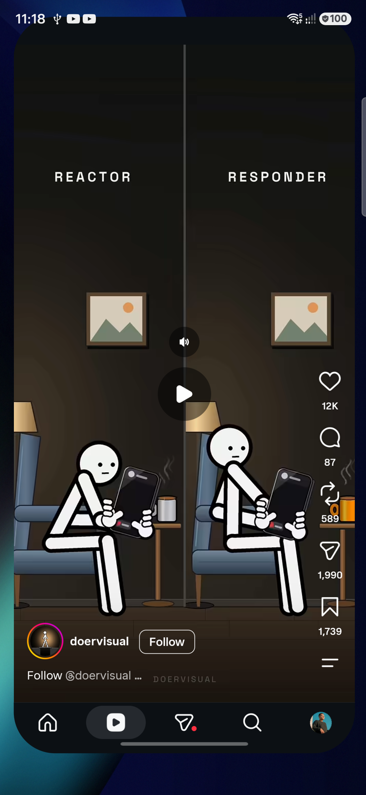
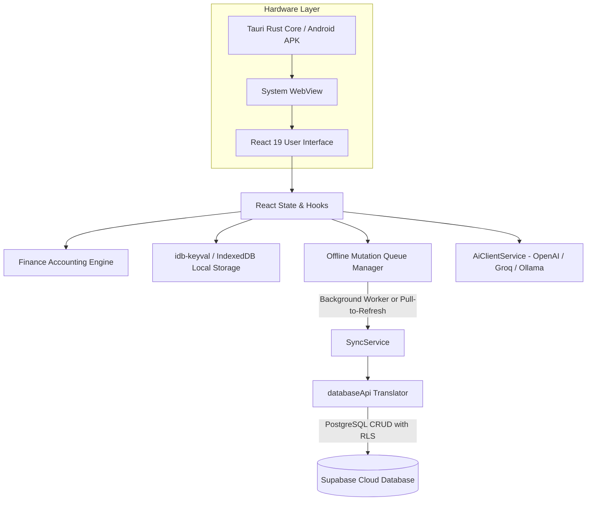
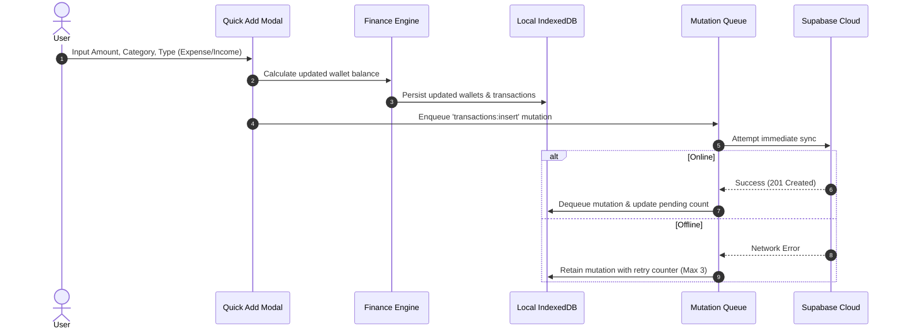
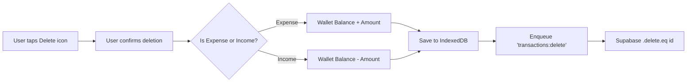
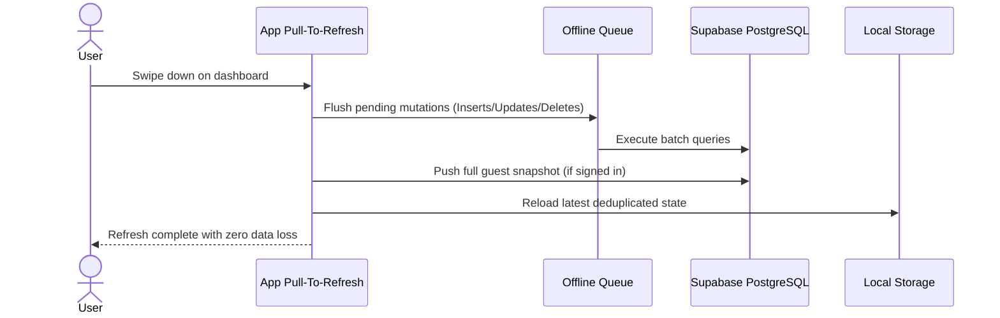

# ⚡ Nova Budget Tracker & Financial Copilot

<div align="center">


**A high-performance personal finance manager and AI financial advisor built with React 19, Tauri 2.0, and Supabase.**  
*Strict accounting rules, offline-first IndexedDB storage, real-time cloud synchronization, and custom OpenAI/Groq/Ollama LLM integration.*

[Architecture](#-system-architecture) • [App Preview](#-app-preview) • [Core Features](#-core-features) • [Data Flow](#-data-flow-charts) • [AI Assistant](#-ai-copilot-setup) • [Installation](#-getting-started)

</div>

---

## 📱 App Preview

<div align="center">
  <table>
    <tr>
      <td align="center" width="25%">
        <b>Home Dashboard</b><br/><br/>
        
      </td>
      <td align="center" width="25%">
        <b>Nova AI Financial Copilot</b><br/><br/>
        
      </td>
      <td align="center" width="25%">
        <b>Money Lent Ledger</b><br/><br/>
        
      </td>
      <td align="center" width="25%">
        <b>Profile & AI Settings</b><br/><br/>
        
      </td>
    </tr>
  </table>
</div>

---

## 🌟 Key Highlights

- **🔒 Offline-First by Design**: Operates seamlessly without internet. Uses IndexedDB and an intelligent retry mutation queue.
- **☁️ Supabase Cloud Sync**: Instant bidirectional synchronization with automatic camelCase to PostgreSQL snake_case translation.
- **🤖 Nova AI Financial Copilot**: Connect any OpenAI-compatible provider (Groq, OpenAI, OpenRouter, Local Ollama) with one-click **Auto Detect** for free models.
- **⚖️ Strict Dual-Ledger Accounting**: Money lent to friends/family is tracked as a receivable asset, completely isolated from expense metrics.
- **🎒 Dual Work/Rest Necessity Caps**: Different daily necessity limits for school/workdays versus weekends/off-days.
- **🎨 Neo-Brutalist & Noir Design**: OLED dark mode, responsive pull-to-refresh, smooth bottom dock, and zero lag on low-end hardware.

---

## 🏗 System Architecture



---

## 📊 Data Flow Charts

### 1. Transaction Logging & Balance Reversal


### 2. Transaction Deletion & Automatic Balance Restoration


### 3. Pull-To-Refresh Synchronization


---

## 🚀 Core Features

### 1. Multi-Wallet System
- Create and manage distinct pockets: **Cash & Pocket**, **Savings Safe**, Emergency Funds, Vaults, or Custom Wallets.
- Real-time balance recalculation with 2-decimal precision.

### 2. Daily Necessity Tracking (Needs vs Wants)
- Set distinct daily necessity budgets:
  - **🎒 Active Days Cap**: Mon, Tue, Thu, Fri, Sat (e.g., ₱500/day)
  - **☕ Rest Days Cap**: Sun, Wed (e.g., ₱150/day)
- Live budget tracker widget with percentage meter and warning alerts when exceeding daily limits.

### 3. Separate Money Lent Ledger
- Money lent out is **not counted as an expense** — it is categorized as a receivable asset.
- Record borrower contact, principal amount, lent date, due date, and repayments.
- Dynamic repayment processor automatically restores returned funds to your chosen wallet.

### 4. Interactive Search & Transaction Feed
- Instant search across notes, borrower names, categories, and numeric amounts.
- Two-step deletion protection (`Delete` / `Cancel`) on each transaction card.

---

## 🤖 AI Copilot Setup

Nova AI connects directly to any OpenAI-compatible API without baking heavy weights into your app or phone memory.

### Supported Providers

| Provider | Base URL | Recommended Model | Free Tier Available |
| :--- | :--- | :--- | :---: |
| **Groq** | `https://api.groq.com/openai/v1` | `llama-3.3-70b-versatile` | Yes |
| **OpenRouter** | `https://openrouter.ai/api/v1` | `meta-llama/llama-3.2-3b-instruct:free` | Yes |
| **OpenAI** | `https://api.openai.com/v1` | `gpt-4o-mini` | Paid |
| **Local Ollama** | `http://localhost:11434/v1` | `llama3.2` | 100% Free / Local |

### How to Configure
1. Open the top-left profile chip on the home dashboard.
2. Scroll to **AI Assistant (Custom Base URL & Model)**.
3. Enter your provider's **Base URL** and **API Key**.
4. Tap **Auto Detect** — the system queries `/models`, prioritizes free models at the top, and populates the dropdown.
5. Tap **Save Profile Changes**.
6. Switch to the center **AI Copilot** tab and start chatting!

---

## 🛠 Getting Started

### Prerequisites
- Node.js (v18 or higher)
- Rust & Cargo (for Tauri build)
- Android SDK & NDK (for mobile build)

### 1. Clone & Install
```bash
git clone https://github.com/REP-Julian/budget-tracker.git
cd budget-tracker
npm install
```

### 2. Configure Environment
Create a `.env` file in the root directory:
```env
VITE_SUPABASE_URL=https://your-project.supabase.co
VITE_SUPABASE_ANON_KEY=your-anon-key-here
```

### 3. Run Development Server
```bash
npm run dev
```

### 4. Run Test Suite
```bash
npm test
```

### 5. Build Universal Android APK
```bash
npm run tauri android build -- --apk
```
The compiled APK will be output to:
```
src-tauri/gen/android/app/build/outputs/apk/universal/release/app-universal-release.apk
```

---

## 🗄 Database Schema

The database uses PostgreSQL on Supabase with Row Level Security (RLS) enabled.

- `bt_wallets`: Stores wallet metadata, icons, types, and current balances.
- `bt_transactions`: Records expenses, income, category, necessity flags, and wallet IDs.
- `bt_loans`: Maintains active, settled, and defaulted lending records.
- `bt_assets`: Stores physical assets, crypto, investments, and net worth entries.
- `bt_profiles`: Preserves user configurations, caps, active days, and AI endpoints.

---

## 📄 License

This project is licensed under the [MIT License](LICENSE).
